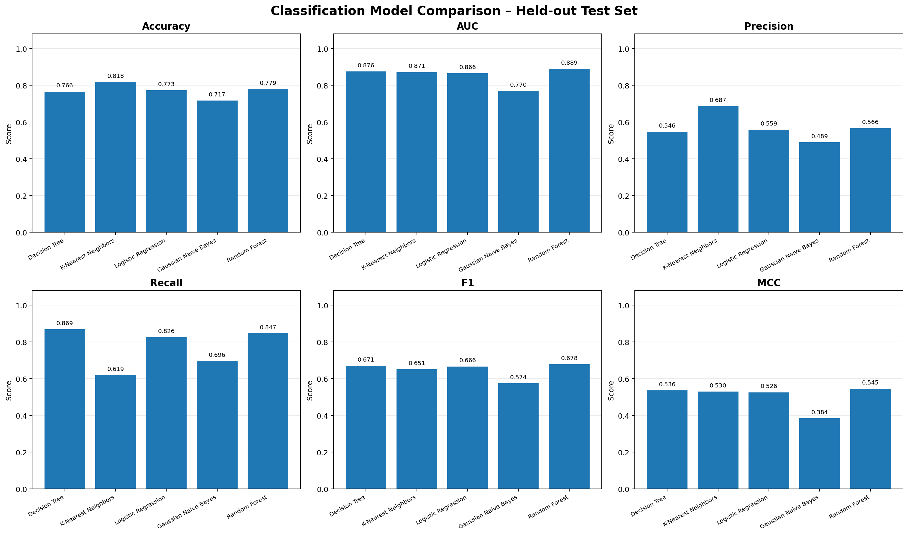

# Machine Learning Assignment 2 – Hotel Booking Cancellation Prediction

## 1. Problem statement

Build and compare five classification models to predict whether a hotel booking will be cancelled (`is_canceled`) using the Hotel Booking Demand dataset.

- `is_canceled = 0`: booking not cancelled
- `is_canceled = 1`: booking cancelled

## 2. Dataset description

- **Dataset:** Hotel Booking Demand
- **Source:** [Kaggle – Hotel Booking Demand](https://www.kaggle.com/datasets/jessemostipak/hotel-booking-demand)
- **Original file:** `data/hotel_bookings.csv`
- **Original dimensions:** 119,390 records and 32 columns (31 candidate predictors plus the target)
- **Target variable:** `is_canceled`
- **Problem type:** Binary classification

The dataset was selected because it meets the assignment's minimum instance and feature requirements and contains numerical and categorical predictors, missing values, and a non-equal target distribution. The target is whether the booking was cancelled.

### Exploratory data analysis findings

| Item | Finding |
|---|---:|
| Original records | 119,390 |
| Original columns | 32 |
| Exact duplicate rows | 31,994 (26.80%) |
| Missing `company` | 112,593 (94.31%) |
| Missing `agent` | 16,340 (13.69%) |
| Missing `country` | 488 (0.41%) |
| Missing `children` | 4 |
| Original non-cancelled bookings (`0`) | 75,166 (62.96%) |
| Original cancelled bookings (`1`) | 44,224 (37.04%) |

### Cleaning and preprocessing decisions

The data-preparation workflow is implemented in `notebooks/01_data_preparation.ipynb`.

1. Exact duplicate rows across all original columns were removed. The source has no unique booking identifier, so identical rows cannot be conclusively distinguished from separate bookings with identical recorded attributes. This limitation is acknowledged.
2. `reservation_status` and `reservation_status_date` were excluded because they describe the final booking outcome and would cause target leakage.
3. `company` was excluded because 94.31% of its original values are missing. This is a documented modelling choice.
4. `agent` is treated as a categorical identifier rather than a continuous number.
5. The one negative `adr` value was treated as missing.
6. Missing `children`, `country`, `agent`, and the invalid `adr` value are retained in the split and must be imputed inside each model's preprocessing pipeline. Fit numerical imputation (median), categorical imputation (for example, `Unknown`), categorical encoding, and scaling on training data only.
7. Unusual zero-adult records were retained rather than automatically removed because the source does not provide enough context to establish that they are invalid.

After exact duplicate removal, the cleaned data contains **87,396 rows**. The final modelling table has **28 predictors plus the target**. After excluding columns, 266 rows appear identical across the remaining fields; these rows are retained because they were not exact duplicates in the original full source.

### Target distribution after exact duplicate removal

| Target | Meaning | Records | Percentage |
|---|---|---:|---:|
| 0 | Not cancelled | 63,371 | 72.51% |
| 1 | Cancelled | 24,025 | 27.49% |

The target is moderately imbalanced. The train-test split is stratified, and the models will be compared using all six required metrics rather than accuracy alone.

## 3. GitHub repository link

[https://github.com/2026ct05092/ML/tree/main/ML-Assignment-2](https://github.com/2026ct05092/ML/tree/main/ML-Assignment-2)

## 4. Models and evaluation

The assignment requires these five models to be implemented on the same dataset and evaluated on the same held-out test set:

1. Logistic Regression – `model/logistic_regression.ipynb`
2. Decision Tree – `model/decision_tree.ipynb`
3. K-Nearest Neighbors – `model/knn.ipynb`
4. Naive Bayes – `model/naive_bayes.ipynb`
5. Random Forest – `model/random_forest.ipynb`

All five models have been executed on the same held-out test partition. The comparison table and six metric visualisations below are generated from the recorded test-set results in `results/model_comparison.csv`. The positive class for Precision, Recall and F1 is `is_canceled = 1` (booking cancelled).

### Experimental result – Logistic Regression

Logistic Regression was executed using the common held-out test set. The six test metrics are:

| Metric | Test result |
|---|---:|
| Accuracy | 0.7728 |
| AUC | 0.8656 |
| Precision (cancelled = 1) | 0.5587 |
| Recall (cancelled = 1) | 0.8256 |
| F1 Score (cancelled = 1) | 0.6664 |
| MCC | 0.5257 |

The model used median imputation and standard scaling for numerical features, constant `Unknown` imputation and one-hot encoding for categorical features, and Logistic Regression with `C=1.0`, `solver='lbfgs'`, `max_iter=1500`, and `class_weight='balanced'`. In the final BITS Virtual Lab run, the train–test accuracy gap was approximately 0.0035 and the AUC gap approximately 0.0030. These small gaps do not show a strong generalisation gap in these two metrics. The model has relatively high recall for cancelled bookings compared with precision, indicating that it catches many cancellations but also produces false-positive cancellation predictions. Its performance is a useful linear baseline for comparison.

### Experimental result – Decision Tree

The Decision Tree was executed on the same held-out test partition. It uses numerical median imputation and categorical `Unknown` imputation plus one-hot encoding; scaling is omitted because it is not required for tree splits. The classifier uses `criterion='gini'`, `max_depth=12`, `min_samples_split=40`, `min_samples_leaf=20`, `class_weight='balanced'`, and `random_state=42`.

| Metric | Training | Test |
|---|---:|---:|
| Accuracy | 0.7838 | 0.7656 |
| AUC | 0.8964 | 0.8756 |
| Precision (cancelled = 1) | 0.5680 | 0.5463 |
| Recall (cancelled = 1) | 0.8912 | 0.8689 |
| F1 Score (cancelled = 1) | 0.6938 | 0.6708 |
| MCC | 0.5718 | 0.5358 |

The Decision Tree has higher recall than precision, indicating that it detects many cancelled bookings but also creates false-positive cancellation predictions. Its train–test accuracy gap is approximately 0.0182 and its AUC gap approximately 0.0208. Compared with Logistic Regression on the same test set, it has higher AUC, recall, F1 and MCC, but slightly lower accuracy and precision. Its largest impurity-based feature importances include `country_PRT`, `lead_time`, `required_car_parking_spaces`, `total_of_special_requests` and `market_segment_Online TA`; these are model-specific associations, not causal explanations. Decision Tree is a strong recall-oriented option, while Random Forest provides the strongest combined AUC, F1 and MCC results.

### Experimental result – K-Nearest Neighbors (KNN)

KNN was executed on the same 69,916-row training partition and 17,480-row held-out test partition. Numerical features were median-imputed and standardised; categorical features were imputed with `Unknown` and one-hot encoded. Because one-hot encoding produces a high-dimensional representation, `TruncatedSVD` reduced the transformed training features to 30 components before KNN. The SVD retained approximately **90.70% cumulative explained variance** and, like the imputers, encoder and scalers, was fitted on training data only. KNN used 15 neighbours, distance weighting and Euclidean distance.

| Metric | Test result |
|---|---:|
| Accuracy | 0.8177 |
| AUC | 0.8709 |
| Precision (cancelled = 1) | 0.6869 |
| Recall (cancelled = 1) | 0.6191 |
| F1 Score (cancelled = 1) | 0.6513 |
| MCC | 0.5297 |

KNN has the highest Accuracy and Precision among all five models, but its Recall is lower: it identifies fewer of the cancelled bookings than Logistic Regression, Decision Tree and Random Forest. Its F1 score and MCC are also below Random Forest and Decision Tree. The 30-component SVD representation is an explicit trade-off to make KNN practical on the high-dimensional data; the reported score is for the complete preprocessing + SVD + KNN pipeline.

### Experimental result – Gaussian Naive Bayes

Gaussian Naive Bayes was executed on the same 69,916-row training partition and 17,480-row held-out test partition. Numerical features were median-imputed and standardised; categorical features were imputed with `Unknown` and one-hot encoded. The final dense transformed matrix contains 570 predictors and uses `float32` to keep memory use practical. GaussianNB models each transformed predictor with a Gaussian class-conditional distribution; this includes 0/1 one-hot indicators, so it is an approximation for categorical variables.

To avoid selecting settings on the held-out test set, `var_smoothing` and the class-1 probability threshold were selected on an internal stratified validation slice from the training partition. The selected settings were `var_smoothing=0.1` and a decision threshold of `0.970`, chosen by maximizing validation MCC (AUC and F1 were tie-breakers). The final pipeline was then refitted on all training rows. The six reported values below are from the untouched external test set.

| Metric | Test result |
|---|---:|
| Accuracy | 0.7165 |
| AUC | 0.7697 |
| Precision (cancelled = 1) | 0.4890 |
| Recall (cancelled = 1) | 0.6957 |
| F1 Score (cancelled = 1) | 0.5743 |
| MCC | 0.3844 |

The model's train–test accuracy gap is approximately 0.0061 and its AUC gap approximately 0.0073; these small gaps do not indicate a large generalisation gap in those two measures. Its test Accuracy, AUC, Precision, F1 and MCC are the lowest among the five models. This suggests GaussianNB is a weaker fit for this dataset, potentially due to the conditional-independence and Gaussian-distribution assumptions. Its Recall is higher than KNN's but lower than the other three models. It still provides a useful baseline for the required model comparison. Because the tuned threshold is 0.970, apply it to `predict_proba(X)[:, 1]` when reproducing the notebook's predicted class labels; the default `pipeline.predict()` uses scikit-learn's 0.5 threshold and will not reproduce the tuned predictions.


### Experimental result – Random Forest

Random Forest was executed on the same 69,916-row training partition and 17,480-row held-out test partition. Numerical features were median-imputed; categorical features were imputed with `Unknown` and one-hot encoded. These transformations were fitted on the training partition only. Scaling was omitted because tree-based models do not require it. The classifier used 250 trees, `max_depth=20`, `min_samples_split=20`, `min_samples_leaf=5`, `max_features='sqrt'`, bootstrap sampling, `class_weight='balanced_subsample'`, and `random_state=42`. Predictions use the default 0.50 probability threshold; no threshold was tuned against the held-out test set.

| Metric | Final test result |
|---|---:|
| Accuracy | 0.7793 |
| AUC | 0.8887 |
| Precision (cancelled = 1) | 0.5659 |
| Recall (cancelled = 1) | 0.8468 |
| F1 Score (cancelled = 1) | 0.6784 |
| MCC | 0.5449 |

Random Forest currently has the highest AUC, F1 Score and MCC among the five evaluated models. It also has high cancellation recall, although Decision Tree's recall is slightly higher. KNN has the highest accuracy and precision. In the final BITS Virtual Lab run, the Random Forest train–test accuracy gap was approximately 0.0136 and its AUC gap approximately 0.0181; these gaps are relatively small and do not show a large generalisation gap in these two measures. Its top impurity-based feature importances are recorded in `results/random_forest_feature_importances.csv` and visualised in `results/visualizations/random_forest_top_feature_importances.png`. Impurity-based importance is descriptive rather than causal and can favour high-cardinality features. Random Forest is selected as the overall winner for balanced performance because it leads on AUC, F1 and MCC while retaining high Recall. KNN remains the leader for Accuracy and Precision, and Decision Tree remains the leader for Recall; therefore, the winner depends on the operational objective.

### Combined test-set comparison (all five models)

The following table reports the six required metrics on the common held-out test set. Values are rounded to four decimal places; the unrounded values are retained in `results/model_comparison.csv`. These are the final BITS Virtual Lab execution results, not the earlier local baseline values.

| Model | Accuracy | AUC | Precision | Recall | F1 | MCC |
|---|---:|---:|---:|---:|---:|---:|
| Logistic Regression | 0.7728 | 0.8656 | 0.5587 | 0.8256 | 0.6664 | 0.5257 |
| Decision Tree | 0.7656 | 0.8756 | 0.5463 | **0.8689** | 0.6708 | 0.5358 |
| K-Nearest Neighbors | **0.8177** | 0.8709 | **0.6869** | 0.6191 | 0.6513 | 0.5297 |
| Gaussian Naive Bayes | 0.7165 | 0.7697 | 0.4890 | 0.6957 | 0.5743 | 0.3844 |
| Random Forest | 0.7793 | **0.8887** | 0.5659 | 0.8468 | **0.6784** | **0.5449** |

### Metric visualisations

The six required evaluation metrics are presented graphically below. Each panel compares all five classifiers on the same held-out test set.



Individual graphs are also available for insertion into the assignment PDF:

- [Accuracy comparison](results/visualizations/accuracy_comparison.png)
- [AUC comparison](results/visualizations/auc_comparison.png)
- [Precision comparison](results/visualizations/precision_comparison.png)
- [Recall comparison](results/visualizations/recall_comparison.png)
- [F1 comparison](results/visualizations/f1_comparison.png)
- [MCC comparison](results/visualizations/mcc_comparison.png)

The graphs are reproducible using `notebooks/02_model_comparison.ipynb` or by running `python scripts/generate_model_comparison.py` from the project root.

### Model-by-model observations

| ML model | Observation about model performance |
|---|---|
| Logistic Regression | Provides a useful linear baseline with 82.56% Recall and 86.56% AUC. Its 55.87% Precision indicates a meaningful number of false-positive cancellation predictions. It balances a high cancellation recall with moderate accuracy. |
| Decision Tree | Achieves the highest Recall (86.89%), so it catches the largest share of cancelled bookings. Its AUC, F1 and MCC are strong, but it has lower Accuracy and Precision than KNN and lower AUC, F1 and MCC than Random Forest. |
| K-Nearest Neighbors | Achieves the highest Accuracy (81.77%) and Precision (68.69%), but its Recall is the lowest (61.91%). It is more conservative about predicting cancellations and therefore misses more actual cancellations. Its results are for the full preprocessing + SVD + KNN pipeline. |
| Gaussian Naive Bayes | Has the lowest Accuracy, AUC, Precision, F1 and MCC among the five models. Its Recall (69.57%) is higher than KNN's but below the other three models. The threshold was selected using a validation slice from training data, not the held-out test set. |
| Random Forest (Ensemble) | Achieves the highest AUC (88.87%), F1 (67.84%) and MCC (54.49%). Its Recall (84.68%) is also high, though slightly below Decision Tree. Accuracy and Precision are lower than KNN. Overall, it provides the strongest balance among the key ranking and classification metrics. |

### Overall winner for this dataset: Random Forest

**Random Forest is the overall winner** when the objective is balanced cancellation detection rather than maximising Accuracy alone. It leads on AUC, F1 and MCC, while maintaining high Recall. AUC measures ranking/discrimination across thresholds; F1 balances Precision and Recall at the selected classification threshold; and MCC incorporates all four confusion-matrix outcomes, making it useful when the target classes are unequal.

This does not mean Random Forest is best for every operational objective. KNN is preferable if the priority is the highest observed Accuracy and Precision, while Decision Tree is preferable if the priority is maximising Recall and catching as many cancellations as possible. The winner reflects the balanced-metric priority adopted for this assignment.

**Limitation:** These results are from one stratified 80:20 hold-out split with `random_state=42`. A different split or external dataset may produce a different ranking. The result should be interpreted as a comparative experiment on this dataset, not as a guarantee of real-world cancellation prediction performance.

## 5. Project structure

```text
ML-Assignment-2/
├── data/
│   ├── hotel_bookings.csv           # original Kaggle dataset
│   └── train_data.csv               # generated 80% training partition
├── notebooks/
│   ├── 01_data_preparation.ipynb   # EDA, cleaning and stratified split
│   └── 02_model_comparison.ipynb    # consolidated metrics and final observations
├── model/
│   ├── logistic_regression.ipynb
│   ├── decision_tree.ipynb
│   ├── knn.ipynb
│   ├── naive_bayes.ipynb
│   ├── random_forest.ipynb
│   └── artifacts/                  # fitted pipelines and configurations for all five classifiers
├── results/
│   ├── eda_missing_values.csv
│   ├── cleaning_summary.csv
│   ├── class_distribution_after_cleaning.csv
│   ├── train_test_class_distribution.csv
│   ├── logistic_regression_metrics.csv
│   ├── decision_tree_metrics.csv
│   ├── knn_metrics.csv
│   ├── knn_test_predictions.csv
│   ├── naive_bayes_metrics.csv
│   ├── naive_bayes_test_predictions.csv
│   ├── naive_bayes_validation_tuning.csv
│   ├── random_forest_metrics.csv
│   ├── random_forest_test_predictions.csv
│   ├── random_forest_feature_importances.csv
│   ├── model_comparison.csv
│   └── visualizations/                 # EDA and model performance plots
├── test_data.csv                    # generated 20% held-out test partition
├── scripts/
│   └── generate_model_comparison.py
├── requirements.txt
├── README.md
└── .gitignore
```

`train_data.csv` is included so all five model notebooks can use the exact same training partition. `test_data.csv` is the held-out 20% test partition required by the assignment and includes the `is_canceled` target column. Both files contain cleaned but not encoded/scaled data; model notebooks must use training-only preprocessing pipelines. The five `.ipynb` files are the submitted model implementations. Serialized `.joblib` pipelines and JSON configurations under `model/artifacts/` are optional generated outputs; they are ignored by Git through `.gitignore` and do not need to be pushed for the stated repository structure.

## 6. Setup and execution

Run these commands from the repository root:

```bash
python -m venv .venv
```

Activate the environment, then install dependencies:

```bash
pip install -r requirements.txt
```

Start Jupyter:

```bash
jupyter notebook
```

Run `notebooks/01_data_preparation.ipynb` first. It creates the shared stratified 80:20 split using `random_state=42`, writes `data/train_data.csv` and `test_data.csv`, and saves EDA summaries and plots under `results/`.

Then run the five notebooks in `model/`. Each model must load the same training and test CSV files. Fit imputers, encoders and scalers on training data only; apply the fitted transformations to test data without refitting. Keep the held-out test set separate from model fitting and tuning. The Naive Bayes notebook uses an additional stratified validation split from the training data to select `var_smoothing` and its decision threshold; it does not tune against the held-out test set. After all model notebooks have run, execute `notebooks/02_model_comparison.ipynb` or run `python scripts/generate_model_comparison.py` to refresh the six consolidated metric graphs from `results/model_comparison.csv`.

### BITS Virtual Lab execution

All seven notebooks (data preparation, the five classifier notebooks, and final model comparison) were executed in the BITS Virtual Lab browser-based development environment using the Python 3.12.7 kernel. The final held-out metrics shown in this README match `results/model_comparison.csv` and the consolidated comparison output captured during that execution. Screenshot evidence for the notebook runs and model comparison has been captured separately for the assignment submission PDF.

## 7. Reproducibility and leakage prevention

- Train-test split: 80:20, stratified by `is_canceled`.
- Random seed: `42`.
- Preprocessing: fitted only on the training partition, preferably within a scikit-learn `Pipeline` / `ColumnTransformer`.
- Target leakage: exclude `reservation_status` and `reservation_status_date` from the predictors.
- Use the same `train_data.csv` and `test_data.csv` in all five model notebooks.

## 8. Current project status

- [x] Original dataset added under `data/`.
- [x] EDA and missing-value analysis implemented.
- [x] Exact duplicate handling and cleaning decisions documented.
- [x] Target leakage fields excluded.
- [x] Stratified 80:20 split generated with `random_state=42`.
- [x] `data/train_data.csv` and required `test_data.csv` generated and validated.
- [x] EDA summary CSVs and visualisations generated.
- [x] Implement and run Logistic Regression; save its six test metrics, confusion matrix, coefficient plot and fitted pipeline.
- [x] Implement and run Decision Tree; save its six test metrics, confusion matrix, ROC curve, feature-importance plot and fitted pipeline.
- [x] Implement and run KNN; save its six test metrics, confusion matrix, ROC curve, metric plot and fitted pipeline.
- [x] Implement and run Gaussian Naive Bayes; tune smoothing and the classification threshold using only a validation slice of the training data, then save its six test metrics, visualisations and fitted pipeline.
- [x] Implement and run Random Forest; save its six test metrics, confusion matrix, ROC curve, metric plot, feature-importance plot and fitted pipeline.
- [x] Generate the five-model comparison table in `results/model_comparison.csv` and add the measured results to this README.
- [x] Generate one consolidated six-metric graph and six individual metric visualisations.
- [x] Document each model's performance observations and explain the overall winner with metric trade-offs.
- [x] Execute all seven notebooks in the BITS Virtual Lab environment.
- [x] Capture BITS Virtual Lab execution screenshots for the preparation notebook, five classifiers, and final model comparison.
- [x] Add the public GitHub repository URL to Section 3.
- [ ] Prepare the single final submission PDF containing the GitHub repository link, BITS Virtual Lab execution screenshot evidence, and complete README content in the order required by the assignment.

## 9. References

- Dataset: [Hotel Booking Demand – Kaggle](https://www.kaggle.com/datasets/jessemostipak/hotel-booking-demand)
- Assignment instructions: ML Assignment 2 – Cognizant, BITS Pilani Work Integrated Learning Programmes Division.
